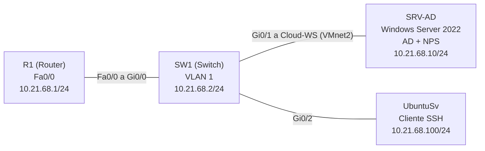
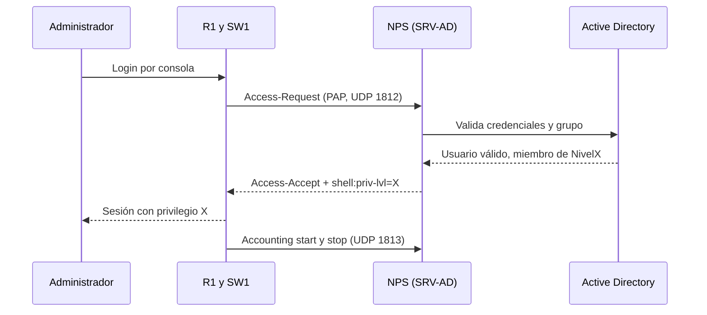
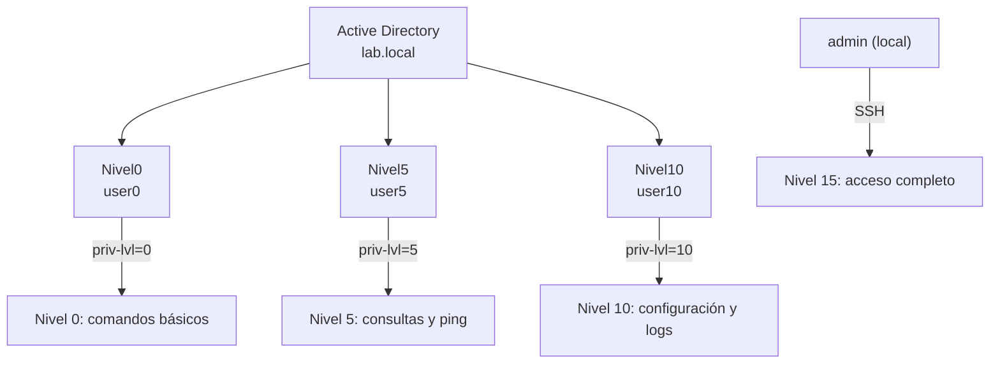

<div align="center">
AAA con RADIUS (NPS) en Router y Switch Cisco
Luis Sebastian Roble Perez · Matrícula 2168 · Asignatura SR


▶ Ver video de demostración
</div>
Un servidor Windows con Active Directory y NPS centraliza la autenticación, la autorización y el registro de acceso a un router y a un switch Cisco. Tres grupos de AD (nivel 0, 5 y 10) determinan el privilegio de cada administrador. La consola y el puerto auxiliar se validan contra RADIUS, y el SSH usa un usuario local.
Contenido: Objetivo · Requisitos · Direccionamiento · Parámetros · Red y diagramas · AD y NPS · Equipos · Funcionamiento · Pruebas · Problemas · Scripts · Estructura
---
Objetivo
Autenticación: la consola y el auxiliar del router y del switch se validan contra RADIUS (NPS) con Active Directory, con un usuario local de respaldo.
Autorización: el grupo de AD define el privilegio (0, 5 o 10), con el principio de mínimo privilegio.
Registro: los accesos correctos y fallidos, los cambios de privilegio y la contabilidad quedan en los equipos y en el servidor.
Acceso remoto: SSH con un usuario local. RADIUS se aplica solo a consola y auxiliar.
---
Cumplimiento de requisitos
Requisito	Implementado con
AAA en autenticación y autorización (router y switch)	`aaa new-model`, listas de autenticación, autorización y contabilidad, y `aaa authorization console`
RADIUS como cliente	`radius server NPS` (`10.21.68.10`, puertos 1812 y 1813) en R1 y SW1, registrados como clientes en NPS
Usuario local	`admin` con privilegio 15 y respaldo `local` en las listas
AAA solo en consola y auxiliar	Lista `CON-AUX` solo en `line con 0` y `line aux 0`. Las vty usan la lista local
Logs de autenticación, autorización y RADIUS	`login on-success/on-failure log`, `logging userinfo`, `logging buffered`, contabilidad `exec` y `system`, y eventos 6272 y 6273 en NPS
SSH	Versión 2 y `transport input ssh` en las vty
AD con grupos de nivel 0, 5 y 10	`Nivel0`, `Nivel5` y `Nivel10` en `lab.local`, con `user0`, `user5` y `user10`
NPS	Tres directivas de red con `Cisco-AV-Pair` = `shell:priv-lvl=X`
Direccionamiento basado en la matrícula	Red `10.21.68.0/24` (dígitos `21` y `68`)
Repositorio con video, documentación, diagramas, imágenes y configs	Este repositorio
---
Direccionamiento IP
Mi matrícula termina en 2168. Los dos primeros dígitos (`21`) forman el segundo octeto y los dos últimos (`68`) el tercero, lo que da la red `10.21.68.0/24`. Con 8 bits de host hay 2⁸ = 256 direcciones, es decir, 254 hosts útiles, suficientes para cuatro equipos.
Dispositivo	Interfaz	IP
R1	FastEthernet0/0	`10.21.68.1/24`
SW1	VLAN 1 (SVI)	`10.21.68.2/24`
SRV-AD (servidor)	Ethernet1 (VMnet2)	`10.21.68.10/24`
UbuntuSv	ens3	`10.21.68.100/24`
Evidencia de direccionamiento y conectividad
IP del servidor Windows	IP del cliente Ubuntu	Ping del servidor a R1 y SW1
		

`show ip interface brief` en R1	`show ip interface brief` en SW1
	
---
Parámetros usados
Parámetro	Valor
Router	Cisco 7200 (`R1`), IOS 15.2(4)S6
Switch	Switch Cisco (`SW1`) en GNS3
Servidor	Windows Server 2022 en VMware (`SRV-AD`), con AD y NPS
Cliente SSH	Ubuntu Server (`UbuntuSv`)
Enlace servidor ↔ topología	Nodo Cloud `Cloud-WS` con `VMnet2`
Dominio	`lab.local`
Grupos y usuarios	`Nivel0` → `user0` · `Nivel5` → `user5` · `Nivel10` → `user10`
RADIUS	UDP 1812 (autenticación), UDP 1813 (contabilidad), método PAP
Atributo de autorización	`Cisco-AV-Pair` = `shell:priv-lvl=<nivel>`, tipo de servicio Login
Listas AAA	`CON-AUX` (consola y auxiliar) y `default` (vty)
Niveles de privilegio	0, 5 y 10 (RADIUS) y 15 (usuario local `admin`)
---
Topología y diagramas
<div align="center">

</div>
<details>
<summary><b>Diagrama lógico</b></summary>

Origen	Destino
`SW1` Gi0/0	`R1` Fa0/0
`SW1` Gi0/1	`Cloud-WS` (VMnet2) → `SRV-AD`
`SW1` Gi0/2	`UbuntuSv`
</details>
<details>
<summary><b>Diagrama de autenticación y autorización</b></summary>

</details>
<details>
<summary><b>Diagrama de acceso por nivel</b></summary>

</details>
---
Active Directory y NPS
Active Directory: dominio `lab.local`, un grupo por nivel y un usuario en cada uno.
<div align="center">

</div>
NPS: clientes RADIUS (R1 y SW1) y las tres directivas de red. Las directivas de nivel se procesan antes de las de "Denegar acceso".
Clientes RADIUS	Directivas de red
	
Detalle de una directiva: condición de grupo y atributo `Cisco-AV-Pair`.
<div align="center">

</div>
Orden	Directiva	Grupo	Autenticación	Atributo devuelto
1	`Nivel-10`	`LAB\Nivel10`	PAP	`shell:priv-lvl=10`
2	`Nivel-5`	`LAB\Nivel5`	PAP	`shell:priv-lvl=5`
3	`Nivel-0`	`LAB\Nivel0`	PAP	`shell:priv-lvl=0`
---
Configuración de los equipos
Router `R1`	Switch `SW1`
	
Las configuraciones finales completas están en la carpeta `show running/`.
---
Funcionamiento
Autenticación. En la consola o el auxiliar, el equipo envía el usuario y la contraseña al NPS (`10.21.68.10`) por RADIUS, que los valida contra Active Directory. Si NPS no responde, se usa el usuario local. Por SSH, las vty usan la lista `default`, que valida contra el usuario local `admin`.
Autorización. NPS identifica el grupo del usuario y aplica su directiva, que responde con `Cisco-AV-Pair` (`shell:priv-lvl=0`, `5` o `10`). El comando `aaa authorization console` hace que el nivel se aplique en la consola.
Contabilidad y logs. Cada sesión `exec` genera un registro de inicio y de cierre hacia NPS, y los eventos del sistema también se contabilizan. En el equipo quedan los accesos correctos y fallidos y los cambios de privilegio. En el servidor, NPS registra los accesos concedidos (evento 6272) y los denegados (evento 6273).
Listas de AAA
Lista	Tipo	Método	Aplicada en
`CON-AUX`	Autenticación de login	`group radius local`	`line con 0` y `line aux 0`
`CON-AUX`	Autorización de `exec`	`group radius local`	`line con 0` y `line aux 0`
`CON-AUX`	Contabilidad de `exec`	`start-stop group radius`	`line con 0` y `line aux 0`
`default`	Autenticación y autorización	`local`	Líneas vty (SSH)
`default`	Contabilidad de `system`	`start-stop group radius`	Global
Niveles de acceso
Grupo	Usuario	Nivel	Qué puede hacer
`Nivel0`	`user0`	0	Solo `disable`, `enable`, `exit`, `help` y `logout`
`Nivel5`	`user5`	5	`ping`, `show privilege`, `show ip interface brief` y `show version`
`Nivel10`	`user10`	10	Lo anterior, más `show running-config` y `show logging`
(local)	`admin`	15	Acceso completo por SSH
Notas
Orden de los `show`: en IOS, al asignar `privilege exec level 10 show running-config`, la palabra `show` pasa a nivel 10. Por eso se definen `show`, `show ip`, `show ip interface` y `show ip interface brief` en nivel 5 de forma explícita.
Auxiliar: `line aux 0` se aplica en los equipos cuya imagen tiene puerto auxiliar (el router).
Visibilidad: en niveles menores a 15, `show running-config` muestra solo lo que ese nivel puede ver.
Mejora futura: autenticar también `enable` contra RADIUS.
---
Pruebas y validación
1. Autenticación contra RADIUS. `test aaa group radius` devuelve el privilegio correcto de cada usuario (`priv-lvl` 0, 5 y 10).
<div align="center">

</div>
2. Acceso por consola por nivel. `user5` consulta interfaces y hace ping, pero `show running-config` es rechazado. `user10` ve la configuración y los logs.
`user5` (nivel 5)	`user10` (nivel 10)
	
3. Login fallido y SSH. Con contraseña incorrecta, RADIUS rechaza el acceso. El usuario local `admin` entra por SSH con privilegio 15.
Login fallido	`admin` por SSH (nivel 15)
	
4. Estado de RADIUS y logs. `show aaa servers` muestra los contadores y `show logging` los accesos correctos, el intento fallido y los cambios de privilegio.
`show aaa servers`	`show logging`
	
5. Registro en el servidor NPS. Los eventos 6272 son accesos concedidos y los 6273 son accesos denegados.
<div align="center">

</div>
---
Problemas y soluciones
Problema	Causa	Solución
La consola rechazaba a todos con `Authentication failed`, sin pedir `Username:`	R1 no alcanzaba el servidor NPS (ping 0/5) y marcaba `RADIUS_DEAD`	Se restableció la conectividad con el servidor. Después el ping dio 5/5 y `test aaa` autenticó a los tres usuarios
No se podía entrar a la consola ni con el usuario local	`CON-AUX` solo usa el respaldo local si RADIUS no responde	Se entró por SSH con `admin` (privilegio 15) para corregir la configuración
`user5` perdía `show privilege` y `show ip interface brief`	Al asignar `show running-config` a nivel 10, `show` pasó a nivel 10	Se definieron los `show` de consulta explícitamente en nivel 5
Un ping fallaba durante las pruebas	La IP del servidor se escribió con un dígito mal (`10.21.67.10`)	Se corrigió a `10.21.68.10`
---
Scripts
> Las contraseñas, claves y hashes no se incluyen en este repositorio.
<details>
<summary><b>R1 (router)</b></summary>
```
enable
configure terminal
hostname R1
username admin privilege 15 secret <contraseña>
enable secret <contraseña>
service password-encryption
ip domain-name lab.local
crypto key generate rsa modulus 2048
ip ssh version 2
ip ssh time-out 60
ip ssh authentication-retries 3
!
aaa new-model
radius server NPS
 address ipv4 10.21.68.10 auth-port 1812 acct-port 1813
 key <secreto-radius>
 exit
aaa authentication login default local
aaa authorization exec default local
aaa authentication login CON-AUX group radius local
aaa authorization console
aaa authorization exec CON-AUX group radius local
aaa accounting exec CON-AUX start-stop group radius
aaa accounting system default start-stop group radius
!
line con 0
 login authentication CON-AUX
 authorization exec CON-AUX
 accounting exec CON-AUX
 logging synchronous
 exec-timeout 10 0
 exit
line aux 0
 login authentication CON-AUX
 authorization exec CON-AUX
 accounting exec CON-AUX
 exec-timeout 10 0
 exit
line vty 0 4
 transport input ssh
 login authentication default
 authorization exec default
 exec-timeout 10 0
 exit
!
service timestamps log datetime msec
logging on
logging buffered 64000 informational
logging userinfo
login on-success log
login on-failure log
!
privilege exec level 5 ping
privilege exec level 5 show
privilege exec level 5 show ip
privilege exec level 5 show ip interface
privilege exec level 5 show ip interface brief
privilege exec level 5 show privilege
privilege exec level 5 show version
privilege exec level 10 show running-config
privilege exec level 10 show logging
end
write memory
```
</details>
<details>
<summary><b>SW1 (switch)</b></summary>
La configuración de seguridad es la misma que la del router (sin `line aux 0` si el equipo no lo tiene). Las diferencias son:
```
hostname SW1
interface vlan 1
 ip address 10.21.68.2 255.255.255.0
 no shutdown
ip default-gateway 10.21.68.1
!
line vty 0 15
 transport input ssh
 login authentication default
 authorization exec default
 exec-timeout 10 0
```
</details>
<details>
<summary><b>Servidor NPS y verificación</b></summary>
Auditoría para que aparezcan los eventos 6272 y 6273 (PowerShell como administrador):
```
auditpol /set /subcategory:"Network Policy Server" /success:enable /failure:enable
```
Comandos de verificación en los equipos:
```
show run | section aaa
show run | section line
show run | include privilege
show aaa servers
show logging | include LOGIN
test aaa group radius user5 <contraseña> new-code
```
</details>
---
Estructura del repositorio
```
README.md
Imagenes/        Capturas de la infraestructura, NPS, pruebas y logs
show running/    Configuraciones finales de R1 y SW1
Scripts/         Comandos de configuración usados en la práctica
```
