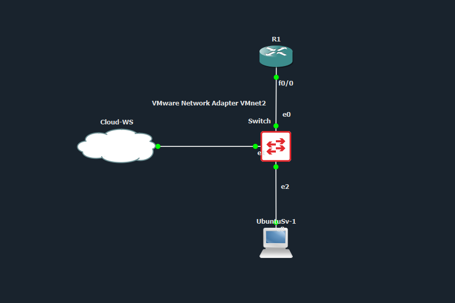
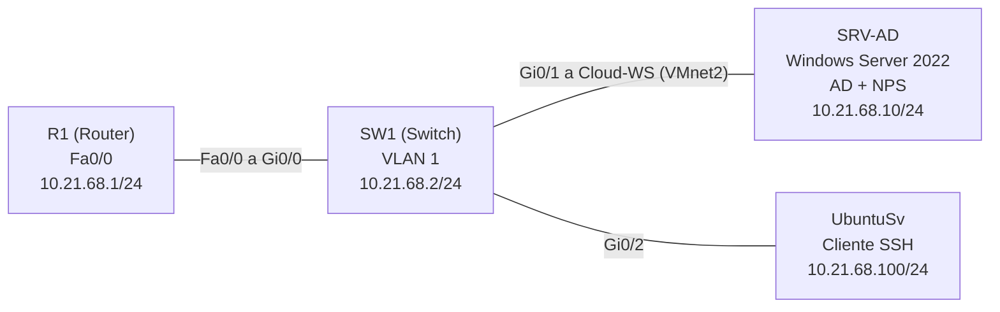
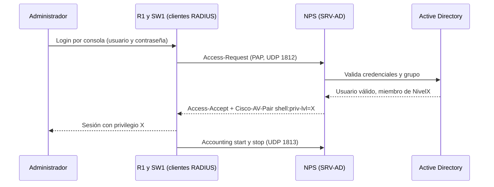
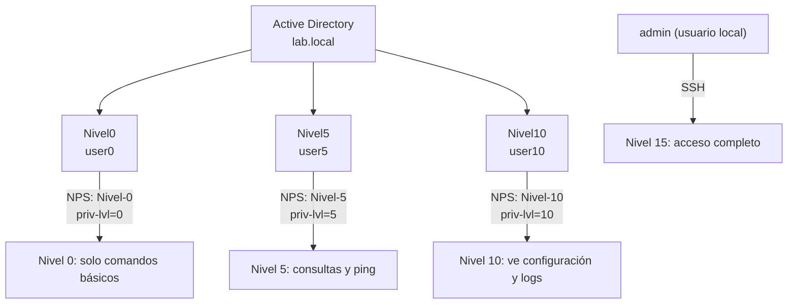
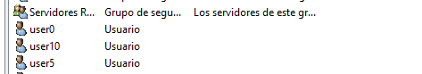

🛡️ Seguridad AAA — RADIUS (NPS) y Active Directory en Router y Switch Cisco
Luis Sebastian Roble Perez — Matrícula 2168 — Asignatura SR


-5C2D91?style=for-the-badge)


> Un servidor Windows con **Active Directory** y **NPS** centraliza la autenticación, la autorización y el registro de acceso a un router y a un switch Cisco. Tres grupos de AD (nivel 0, 5 y 10) determinan el privilegio que recibe cada administrador. La consola y el puerto auxiliar se validan contra RADIUS, y el SSH usa un usuario local.
---
📺 Video de Demostración
> [**Ver demostración en YouTube →**](https://youtu.be/rcTKsu8TtT4)
---
📑 Tabla de Contenido
Propósito del Laboratorio
Cumplimiento de Requisitos
Direccionamiento IP basado en la matrícula
Parámetros Usados
Documentación de la Red
Funcionamiento de la Configuración
Validación de la Implementación
Problemas Encontrados y Soluciones
Scripts de Configuración
Estructura del Repositorio
---
🎯 Propósito del Laboratorio
Demostrar el acceso administrativo seguro a equipos de red mediante AAA (autenticación, autorización y contabilidad), aplicando estas políticas:
La autenticación de la consola y del puerto auxiliar del router y del switch se valida contra un servidor RADIUS (NPS) integrado con Active Directory, con un usuario local como respaldo.
La autorización se define por grupo de AD: el nivel 0, el nivel 5 y el nivel 10 reciben privilegios distintos en el equipo, siguiendo el principio de mínimo privilegio.
Los accesos correctos y fallidos, los cambios de privilegio y la contabilidad RADIUS quedan registrados en los equipos y en el servidor.
La administración remota se hace por SSH con un usuario local.
AAA por RADIUS se aplica solo a los puertos de consola y auxiliar.
---
✅ Cumplimiento de Requisitos
Requisito	Implementado con
Seguridad en todos los niveles de autenticación y autorización (router y switch)	`aaa new-model` con listas de autenticación, autorización y contabilidad, privilegios 0, 5, 10 y 15 y `aaa authorization console`
RADIUS como cliente	`radius server NPS` (`10.21.68.10`, autenticación 1812 y contabilidad 1813) en R1 y SW1. Ambos están registrados en NPS como clientes RADIUS
Usuario local	`admin` con privilegio 15 en cada equipo, y respaldo local (`local`) en las listas de AAA
AAA solo en consola y auxiliar	Lista `CON-AUX` aplicada únicamente a `line con 0` y `line aux 0`. Las líneas vty usan la lista por defecto (local)
Logs de autenticación, autorización y RADIUS	`login on-success log`, `login on-failure log`, `logging userinfo`, `logging buffered`, contabilidad `exec` y `system` hacia RADIUS, y eventos 6272 y 6273 en NPS
Servicio SSH	SSH versión 2 y `transport input ssh` en las líneas vty
Active Directory con un grupo de nivel 0, 5 y 10	Grupos `Nivel0`, `Nivel5` y `Nivel10` en el dominio `lab.local`, con un usuario por grupo (`user0`, `user5` y `user10`)
Servicio NPS	Rol NPS con tres directivas de red (`Nivel-0`, `Nivel-5` y `Nivel-10`) que devuelven el privilegio en el atributo `Cisco-AV-Pair`
Direccionamiento basado en la matrícula	Red `10.21.68.0/24`, derivada de los dígitos `21` y `68` de la matrícula
Repositorio con video, documentación, diagramas, imágenes, scripts y running-configs	Este repositorio
---
🧮 Direccionamiento IP basado en la matrícula
1. Origen de las direcciones
Mi matrícula termina en 2168. Separé esos cuatro dígitos en dos pares, `21` y `68`:
Dígitos de la matrícula	Dónde se usan	Ejemplo
`21` → segundo octeto	Red privada de la infraestructura	10.21.68.0
`68` → tercer octeto	Red privada de la infraestructura	10.21.68.0
2. Red utilizada
Una sola red de administración con cuatro equipos, así que un prefijo /24 es suficiente:
Segmento	Prefijo	Máscara	Hosts útiles	Red	Rango utilizable	Broadcast
Administración	/24	255.255.255.0	254	10.21.68.0	10.21.68.1 – 10.21.68.254	10.21.68.255
Cálculo del prefijo: 32 − 24 = 8 bits de host → 2⁸ = 256 direcciones → 254 hosts útiles.
3. Asignación de direcciones
Dispositivo	Interfaz	IP	Subred
R1	FastEthernet0/0	10.21.68.1	10.21.68.0/24
SW1	VLAN 1 (SVI)	10.21.68.2	10.21.68.0/24
SRV-AD (servidor)	Ethernet1 (VMnet2)	10.21.68.10	10.21.68.0/24
UbuntuSv	ens3	10.21.68.100	10.21.68.0/24
Evidencia:
IP del servidor Windows (`ipconfig`):

IP del cliente Ubuntu (`ip a`):

Conectividad del servidor hacia el router y el switch:

Interfaces del router:

Interfaces del switch:

---
🧩 Parámetros Usados
Parámetro	Valor
Router	Cisco 7200 (`R1`), IOS 15.2(4)S6, imagen `c7200-adventerprisek9`
Switch	Switch Cisco (`SW1`) en GNS3
Servidor	Windows Server 2022 en VMware (`SRV-AD`) con Active Directory y NPS
Cliente SSH	Ubuntu Server (`UbuntuSv`)
Emulador	GNS3
Enlace servidor ↔ topología	Nodo Cloud `Cloud-WS` con la red virtual `VMnet2`
Dominio de Active Directory	`lab.local`
Grupos y usuarios	`Nivel0` → `user0`, `Nivel5` → `user5`, `Nivel10` → `user10`
RADIUS	Autenticación UDP 1812, contabilidad UDP 1813, método de autenticación PAP
Atributo de autorización	`Cisco-AV-Pair` = `shell:priv-lvl=<nivel>`, con tipo de servicio Inicio de sesión (Login)
Listas AAA	`CON-AUX` (consola y auxiliar) y las listas por defecto (vty)
SSH	Versión 2 con `transport input ssh` en las líneas vty
Niveles de privilegio	0, 5 y 10 (por RADIUS) y 15 (usuario local `admin`)
---
📡 Documentación de la Red
Topología

Diagrama lógico

Origen	Destino
`SW1` GigabitEthernet0/0	`R1` FastEthernet0/0
`SW1` GigabitEthernet0/1	`Cloud-WS` (VMnet2) → `SRV-AD`
`SW1` GigabitEthernet0/2	`UbuntuSv`
Diagrama de autenticación y autorización

Diagrama de acceso (qué puede hacer cada nivel)

Active Directory
Grupos de nivel 0, 5 y 10 con sus usuarios en el dominio `lab.local`:

NPS (servidor RADIUS)
Clientes RADIUS (el router y el switch):

Directivas de red en orden. Las tres directivas de nivel se procesan antes de las de "Denegar acceso":

Detalle de una de las directivas, con la condición de grupo y el atributo `Cisco-AV-Pair`:

Router y switch
Configuración de AAA, RADIUS y SSH verificada en `R1`:

Configuración de AAA, RADIUS y SSH verificada en `SW1`:

---
🔬 Funcionamiento de la Configuración
Autenticación: al entrar por la consola o el puerto auxiliar, el equipo pide usuario y contraseña y los envía al servidor NPS (`10.21.68.10`) por RADIUS. NPS los valida contra Active Directory. Si NPS no responde, el equipo usa el usuario local como respaldo. Por SSH, las líneas vty usan la lista por defecto, que valida contra el usuario local `admin`.
Autorización: NPS comprueba a qué grupo de AD pertenece el usuario y aplica la directiva de red que corresponde. Esa directiva responde con el atributo `Cisco-AV-Pair` (`shell:priv-lvl=0`, `5` o `10`), y el equipo le asigna ese nivel de privilegio. El comando `aaa authorization console` es necesario para que el nivel se aplique en la consola.
Contabilidad y logs: cada sesión de `exec` genera un registro de inicio y de cierre hacia NPS, y los eventos del sistema también se contabilizan. En el equipo quedan los eventos de acceso correcto y fallido, y los cambios de privilegio. En el servidor, NPS registra los accesos concedidos (evento 6272) y los denegados (evento 6273).
Listas de AAA (en R1 y SW1):
Lista	Tipo	Método	Aplicada en
`CON-AUX`	Autenticación de login	`group radius local`	`line con 0` y `line aux 0`
`CON-AUX`	Autorización de `exec`	`group radius local`	`line con 0` y `line aux 0`
`CON-AUX`	Contabilidad de `exec`	`start-stop group radius`	`line con 0` y `line aux 0`
`default`	Autenticación de login y autorización de `exec`	`local`	Líneas vty (SSH)
`default`	Contabilidad de `system`	`start-stop group radius`	Global
Directivas de red en NPS:
Orden	Directiva	Condición	Autenticación	Atributo devuelto
1	`Nivel-10`	Grupo `LAB\Nivel10`	PAP	`Cisco-AV-Pair` = `shell:priv-lvl=10`
2	`Nivel-5`	Grupo `LAB\Nivel5`	PAP	`Cisco-AV-Pair` = `shell:priv-lvl=5`
3	`Nivel-0`	Grupo `LAB\Nivel0`	PAP	`Cisco-AV-Pair` = `shell:priv-lvl=0`
Niveles de acceso:
Grupo de AD	Usuario	Privilegio	Qué puede hacer
`Nivel0`	`user0`	0	Solo `disable`, `enable`, `exit`, `help` y `logout`
`Nivel5`	`user5`	5	Consultas básicas (`show privilege`, `show ip interface brief`, `show version`) y `ping`
`Nivel10`	`user10`	10	Lo anterior, más `show running-config` y `show logging`
(local)	`admin`	15	Acceso completo por SSH
Notas:
Orden de los comandos `show`: en IOS, al asignar `privilege exec level 10 show running-config`, la palabra `show` queda en nivel 10, aunque antes se haya puesto en nivel 5. Por eso se definen explícitamente `show`, `show ip`, `show ip interface` y `show ip interface brief` en nivel 5, para que `user5` conserve sus consultas.
Auxiliar: la configuración de `line aux 0` se aplica en los equipos cuya imagen incluye puerto auxiliar (el router). Si el switch no lo tiene, el comando no aplica.
Visibilidad de la configuración: en niveles menores a 15, `show running-config` muestra solo las partes de la configuración que ese nivel puede ver.
Mejora futura: el comando `enable` con la contraseña de `enable secret` permite subir a nivel 15 desde cualquier usuario. Una mejora sería autenticar también `enable` contra el servidor RADIUS.
---
✅ Validación de la Implementación
Pruebas de autenticación contra RADIUS
Con `test aaa group radius`, NPS devuelve el privilegio correcto para cada usuario (`priv-lvl` 0, 5 y 10):

Pruebas por consola
Prueba 1 — Nivel 5: `user5` tiene privilegio 5, consulta las interfaces y hace ping, pero `show running-config` es rechazado.

Prueba 2 — Nivel 10: `user10` tiene privilegio 10 y ve la configuración y los logs.

Prueba 3 — Login fallido: con una contraseña incorrecta, RADIUS rechaza el acceso y el equipo no abre la sesión.

Pruebas de SSH
Prueba 4 — SSH con el usuario local: `admin` entra por SSH con privilegio 15.

Estado de RADIUS y logs
Prueba 5 — Estado de RADIUS: `show aaa servers` muestra los contadores de autenticación y contabilidad.

Prueba 6 — Logs en el equipo: `show logging` muestra los accesos correctos, el intento fallido, los eventos de RADIUS y los cambios de privilegio.

Servidor NPS
Prueba 7 — Registro en el servidor: los eventos 6272 son accesos concedidos y los 6273 son accesos denegados, incluidos los intentos con contraseña incorrecta.

---
🧯 Problemas Encontrados y Soluciones
Problema	Causa	Solución
La consola rechazaba todos los usuarios con `Authentication failed`, sin pedir `Username:`	El servidor NPS no era alcanzable desde R1 (`ping` 0/5) y el router marcaba `RADIUS_DEAD`	Se restableció la conectividad con el servidor (IP y enlace VMnet2). Después `ping` dio 5/5 y `test aaa group radius` autenticó a los tres usuarios
No se podía entrar a la consola ni siquiera con el usuario local	La lista `CON-AUX` solo usa el respaldo local si RADIUS no responde, y las vty usan una lista distinta	Se entró por SSH con `admin` (privilegio 15) para corregir la configuración
`user5` perdía `show privilege` y `show ip interface brief`	Al asignar `show running-config` a nivel 10, la palabra `show` pasó a nivel 10	Se definieron `show`, `show ip`, `show ip interface` y `show ip interface brief` explícitamente en nivel 5
`ping` fallaba una vez durante las pruebas	Se escribió la IP del servidor con un error de dígito (`10.21.67.10` en lugar de `10.21.68.10`)	Se corrigió la IP. El servidor es `10.21.68.10`
---
📜 Scripts de Configuración
> Las contraseñas, claves y hashes no se incluyen en este repositorio.
R1 (router)
```
enable
configure terminal
hostname R1
username admin privilege 15 secret <contraseña>
enable secret <contraseña>
service password-encryption
ip domain-name lab.local
crypto key generate rsa modulus 2048
ip ssh version 2
ip ssh time-out 60
ip ssh authentication-retries 3
!
aaa new-model
radius server NPS
 address ipv4 10.21.68.10 auth-port 1812 acct-port 1813
 key <secreto-radius>
 exit
aaa authentication login default local
aaa authorization exec default local
aaa authentication login CON-AUX group radius local
aaa authorization console
aaa authorization exec CON-AUX group radius local
aaa accounting exec CON-AUX start-stop group radius
aaa accounting system default start-stop group radius
!
line con 0
 login authentication CON-AUX
 authorization exec CON-AUX
 accounting exec CON-AUX
 logging synchronous
 exec-timeout 10 0
 exit
line aux 0
 login authentication CON-AUX
 authorization exec CON-AUX
 accounting exec CON-AUX
 exec-timeout 10 0
 exit
line vty 0 4
 transport input ssh
 login authentication default
 authorization exec default
 exec-timeout 10 0
 exit
!
service timestamps log datetime msec
logging on
logging buffered 64000 informational
logging userinfo
login on-success log
login on-failure log
!
privilege exec level 5 ping
privilege exec level 5 show
privilege exec level 5 show ip
privilege exec level 5 show ip interface
privilege exec level 5 show ip interface brief
privilege exec level 5 show privilege
privilege exec level 5 show version
privilege exec level 10 show running-config
privilege exec level 10 show logging
end
write memory
```
SW1 (switch)
La configuración de seguridad es la misma que la del router, sin `line aux 0` si el equipo no lo tiene. Las diferencias son:
```
hostname SW1
interface vlan 1
 ip address 10.21.68.2 255.255.255.0
 no shutdown
ip default-gateway 10.21.68.1
!
line vty 0 15
 transport input ssh
 login authentication default
 authorization exec default
 exec-timeout 10 0
```
Servidor (NPS): auditoría para que aparezcan los eventos 6272 y 6273:
```
auditpol /set /subcategory:"Network Policy Server" /success:enable /failure:enable
```
Verificación en los equipos:
```
show run | section aaa
show run | section line
show run | include privilege
show aaa servers
show logging | include LOGIN
test aaa group radius user5 <contraseña> new-code
```
---
📁 Estructura del Repositorio
```
README.md
Imagenes/        Capturas de la infraestructura, NPS, pruebas y logs
show running/    Configuraciones finales de R1 y SW1 (Router.txt y SW1#show running.txt)
Scripts/         Comandos de configuración usados en la práctica
```
