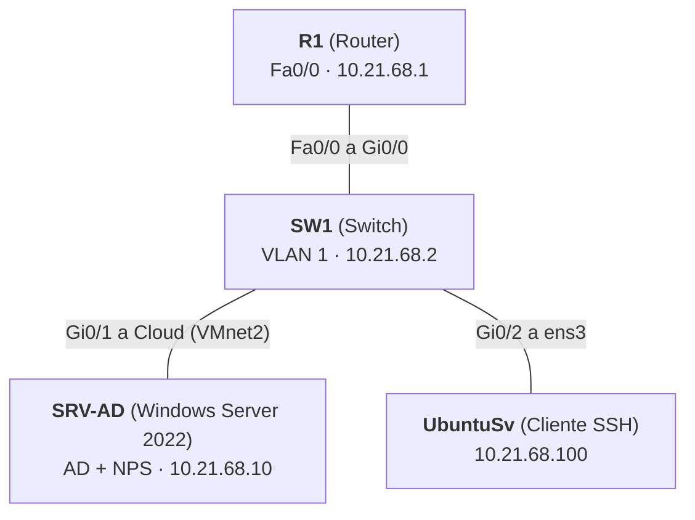

<h1 align="center">Práctica 2: AAA con RADIUS (NPS) en Router y Switch Cisco</h1>
<p align="center">
  <b>Autenticación, autorización y registro (AAA) centralizados con Active Directory y Network Policy Server</b>
</p>
<p align="center">
  
  
  
  
  
</p>
---
Contenido
Descripción general
Topología
Direccionamiento
Servidor Windows (AD y NPS)
Router y Switch
Usuarios y niveles de privilegio
Evidencias
Running-configs
---
1. Descripción general
Se implementa un esquema AAA en un router y un switch Cisco. La autenticación y la autorización de los accesos por consola y auxiliar se delegan a un servidor RADIUS (NPS) integrado con Active Directory, que asigna el nivel de privilegio según el grupo del usuario. El acceso por SSH se mantiene con un usuario local, que además sirve de respaldo si el servidor RADIUS no responde.
Requisitos cumplidos en cada equipo (router y switch):
Requisito	Estado
Seguridad de autenticación y autorización	Cumplido
RADIUS configurado como cliente	Cumplido
Usuario local	Cumplido
Autenticación y autorización solo en consola y auxiliar	Cumplido
Logs de autenticación, autorización y RADIUS	Cumplido
Servicio SSH	Cumplido
---
2. Topología
<p align="center">
  
  <br>
  <sub><b>Figura 1.</b> Topología implementada en GNS3.</sub>
</p>

---
3. Direccionamiento
Red: `10.21.68.0/24`  |  Máscara: `255.255.255.0`  |  Gateway: `10.21.68.1`
Dispositivo	Interfaz	Dirección IP	Función
R1	FastEthernet0/0	`10.21.68.1`	Router, cliente RADIUS
SW1	VLAN 1	`10.21.68.2`	Switch, cliente RADIUS
SRV-AD	Ethernet1 (VMnet2)	`10.21.68.10`	Active Directory y NPS
UbuntuSv	ens3	`10.21.68.100`	Cliente SSH
---
4. Servidor Windows (AD y NPS)
4.1 Active Directory
Dominio: `lab.local`. Se crea un grupo por nivel de privilegio, cada uno con un usuario.
Grupo	Usuario	Nivel asignado
Nivel0	`user0`	0
Nivel5	`user5`	5
Nivel10	`user10`	10
4.2 Network Policy Server (NPS)
Clientes RADIUS: `R1` (10.21.68.1) y `SW1` (10.21.68.2), con clave compartida. Puertos UDP 1812 (autenticación) y 1813 (accounting).
Políticas de red. Autenticación PAP, `Service-Type = Login` y atributo específico del proveedor `Cisco-AV-Pair`:
Orden	Política	Condición (grupo de Windows)	Cisco-AV-Pair
1	Nivel-10	`LAB\Nivel10`	`shell:priv-lvl=10`
2	Nivel-5	`LAB\Nivel5`	`shell:priv-lvl=5`
3	Nivel-0	`LAB\Nivel0`	`shell:priv-lvl=0`
> **Nota:** las tres políticas deben procesarse **antes** de las dos políticas por defecto de "Denegar acceso"; de lo contrario NPS rechaza a los usuarios.
<p align="center">
  
  <br>
  <sub><b>Figura 2.</b> Políticas de red configuradas en NPS.</sub>
</p>
---
5. Router y Switch
La configuración es equivalente en R1 y SW1; solo cambian el nombre y la interfaz con IP.
Requisito	Implementación
Seguridad AAA	`aaa new-model`, `aaa authentication login`, `aaa authorization exec`
RADIUS como cliente	`radius server NPS` hacia `10.21.68.10` (1812/1813)
Usuario local	`username admin privilege 15 secret ...`
Solo consola y auxiliar	Lista `CON-AUX` (RADIUS y luego local) aplicada únicamente en `line con 0` y `line aux 0`. Las líneas VTY usan solo la lista local
Logs	`login on-success log`, `login on-failure log`, `aaa accounting exec/system` hacia RADIUS, `logging buffered`
Servicio SSH	`ip domain-name`, llaves RSA de 2048 bits, `ip ssh version 2`, `transport input ssh`
Comandos principales:
```
aaa new-model
radius server NPS
 address ipv4 10.21.68.10 auth-port 1812 acct-port 1813
 key ********

aaa authentication login default local
aaa authorization exec default local
aaa authentication login CON-AUX group radius local
aaa authorization exec CON-AUX group radius local
aaa accounting exec default start-stop group radius
aaa accounting system default start-stop group radius

line con 0
 login authentication CON-AUX
 authorization exec CON-AUX
line aux 0
 login authentication CON-AUX
 authorization exec CON-AUX
line vty 0 4
 transport input ssh
 login authentication default
 authorization exec default

login on-success log
login on-failure log
logging buffered 16384 informational
```
---
6. Usuarios y niveles de privilegio
Usuario	Origen	Acceso	Nivel
`admin`	Local	SSH y respaldo si RADIUS no responde	15
`user0`	Active Directory (RADIUS)	Consola	0
`user5`	Active Directory (RADIUS)	Consola	5
`user10`	Active Directory (RADIUS)	Consola	10
---
7. Evidencias
7.1 Configuración de los equipos
Usuario local, RADIUS, AAA, líneas, SSH y estado de interfaces.
<p align="center">
  
  <br>
  <sub><b>Figura 3.</b> Configuración del router R1.</sub>
</p>
<p align="center">
  
  <br>
  <sub><b>Figura 4.</b> Configuración del switch SW1.</sub>
</p>
7.2 Niveles de privilegio
Nivel inicial asignado por NPS, verificado con `show privilege` antes de usar `enable`.
<p align="center">
  
  <br>
  <sub><b>Figura 5.</b> <code>user0</code>: nivel 0.</sub>
</p>
<p align="center">
  
  <br>
  <sub><b>Figura 6.</b> <code>user5</code>: nivel 5.</sub>
</p>
<p align="center">
  
  <br>
  <sub><b>Figura 7.</b> <code>user10</code>: nivel 10.</sub>
</p>
<p align="center">
  
  <br>
  <sub><b>Figura 8.</b> Demostración de los tres niveles de privilegio.</sub>
</p>
7.3 Logs
<p align="center">
  
  <br>
  <sub><b>Figura 9.</b> Logs de autenticación, autorización y RADIUS.</sub>
</p>
---
8. Running-configs
Equipo	Archivo
R1 (Router)	`configs/R1-running-config.txt`
SW1 (Switch)	`configs/SW1-running-config.txt`
