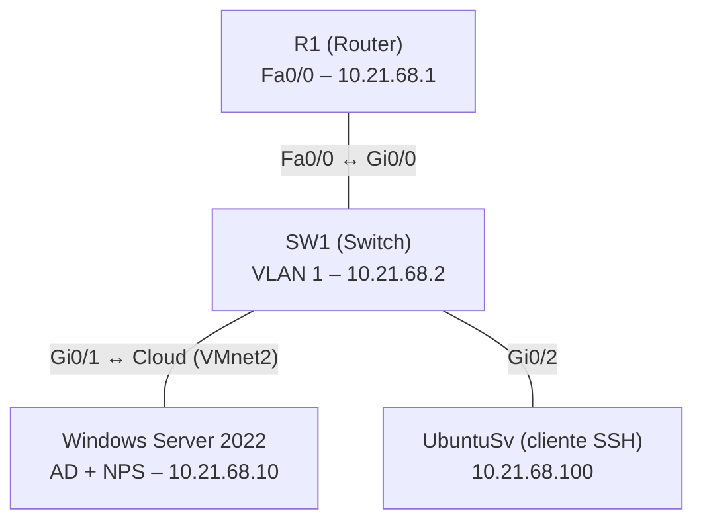

Práctica 2 – AAA con RADIUS (NPS) en Router y Switch Cisco
Autenticación, autorización y logs (AAA) en un router y un switch Cisco, usando RADIUS contra Network Policy Server (NPS) de Windows Server 2022 con Active Directory. Direccionamiento basado en la matrícula 2168.
Topología


Direccionamiento
Red: `10.21.68.0/24` · Máscara: `255.255.255.0` · Gateway: `10.21.68.1`
Dispositivo	Interfaz	Dirección IP
R1 (Router)	FastEthernet0/0	10.21.68.1
SW1 (Switch)	VLAN 1	10.21.68.2
Servidor Windows (SRV-AD)	Ethernet1 (VMnet2)	10.21.68.10
UbuntuSv	ens3	10.21.68.100
Infraestructura
Servidor (Windows Server 2022)
Dominio: `lab.local`
Active Directory: un grupo por nivel de privilegio, cada uno con un usuario.
Grupo	Usuario	Nivel
Nivel0	user0	0
Nivel5	user5	5
Nivel10	user10	10
NPS:
Clientes RADIUS: `R1` (10.21.68.1) y `SW1` (10.21.68.2).
Tres políticas de red (autenticación PAP, `Service-Type = Login`), cada una con el atributo `Cisco-AV-Pair`:
Orden	Política	Condición (grupo)	Cisco-AV-Pair
1	Nivel-10	LAB\Nivel10	`shell:priv-lvl=10`
2	Nivel-5	LAB\Nivel5	`shell:priv-lvl=5`
3	Nivel-0	LAB\Nivel0	`shell:priv-lvl=0`
> Las políticas deben quedar **antes** de las dos políticas por defecto de "Denegar acceso".

Router (R1) y Switch (SW1)
La configuración es equivalente en ambos equipos.
Requisito	Implementación
Seguridad de autenticación y autorización	`aaa new-model`, `aaa authentication login`, `aaa authorization exec`
RADIUS como cliente	`radius server NPS` → 10.21.68.10 (puertos 1812/1813)
Usuario local	`username admin privilege 15 secret ...`
AAA solo en consola y auxiliar	Lista `CON-AUX` (RADIUS → local) únicamente en `line con 0` y `line aux 0`; las líneas VTY usan solo la lista local
Logs de autenticación, autorización y RADIUS	`login on-success log`, `login on-failure log`, `aaa accounting exec/system` hacia RADIUS, `logging buffered`
Servicio SSH	`ip domain-name`, llaves RSA 2048, `ip ssh version 2`, `transport input ssh`
Comandos clave:
```
aaa new-model
radius server NPS
 address ipv4 10.21.68.10 auth-port 1812 acct-port 1813
 key ********
aaa authentication login default local
aaa authorization exec default local
aaa authentication login CON-AUX group radius local
aaa authorization exec CON-AUX group radius local
aaa accounting exec default start-stop group radius
aaa accounting system default start-stop group radius

line con 0
 login authentication CON-AUX
 authorization exec CON-AUX
line aux 0
 login authentication CON-AUX
 authorization exec CON-AUX
line vty 0 4
 transport input ssh
 login authentication default
 authorization exec default

login on-success log
login on-failure log
logging buffered 16384 informational
```
Usuarios de prueba
Usuario	Origen	Uso	Nivel
admin	Local	SSH y respaldo si RADIUS no responde	15
user0	Active Directory (RADIUS)	Consola	0
user5	Active Directory (RADIUS)	Consola	5
user10	Active Directory (RADIUS)	Consola	10
Evidencias
Configuración: usuario local, RADIUS, AAA, líneas, SSH e interfaces
Router

Switch

Niveles de privilegio
Nivel inicial asignado por NPS (`show privilege` antes de usar `enable`).
user0 – nivel 0

user5 – nivel 5

user10 – nivel 10

Demostración de los tres niveles

Logs

Running-configs
R1-running-config.txt
SW1-running-config.txt
