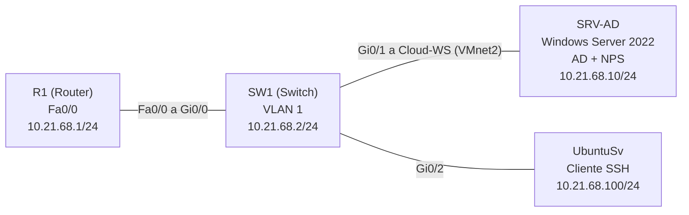
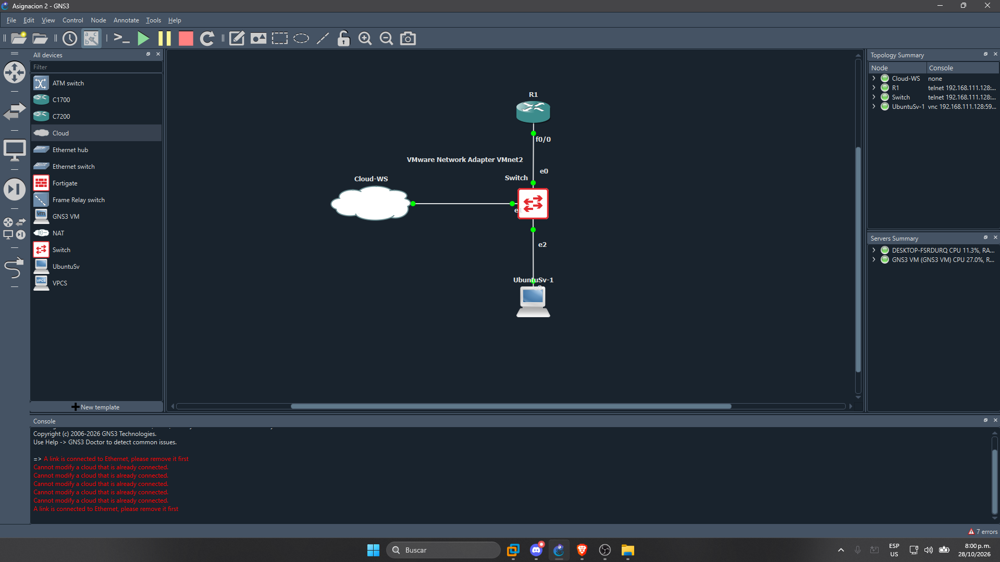
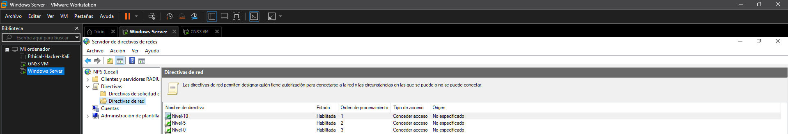
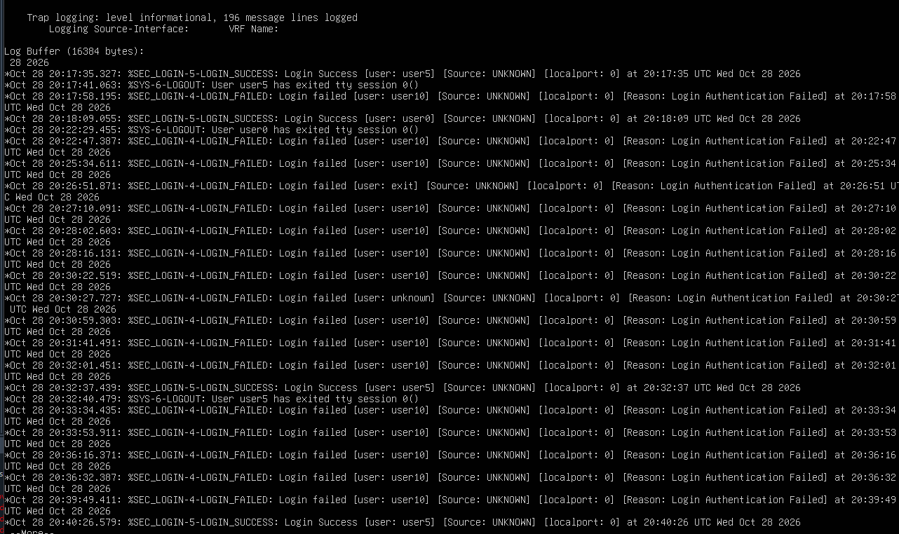

# Práctica #2 — AAA con RADIUS (NPS) en Router y Switch Cisco> **Video de demostración:** [Ver video](#)
Asignatura: [SR] Estudiante: [Luis Sebastian Roble Perez] Matrícula: 2168
---
1. Objetivo
Armar en GNS3 una red con un router y un switch Cisco cuyo acceso por consola y auxiliar se autentique y autorice contra un servidor RADIUS (NPS) en Windows Server 2022, integrado con Active Directory, y que el acceso por SSH funcione con un usuario local.
Lo que se busca demostrar:
El router y el switch tienen seguridad AAA de autenticación y autorización.
Ambos equipos están configurados como clientes RADIUS del servidor NPS.
Cada equipo tiene un usuario local que sirve de respaldo si el servidor no responde.
RADIUS solo se usa en los puertos de consola y auxiliar; las líneas VTY usan el usuario local.
Active Directory tiene tres grupos (nivel 0, 5 y 10) y NPS asigna el nivel de privilegio según el grupo.
Los logs de autenticación, autorización y RADIUS están habilitados.
El servicio SSH está activo en el router y en el switch.
---
2. Topología


---
3. Direccionamiento
La red sale de mi matrícula, 2168: `10.21.68.0/24`, máscara `255.255.255.0` y gateway `10.21.68.1`.
Equipo	Interfaz	Dirección
R1	Fa0/0 hacia Switch	`10.21.68.1/24`
SW1	Gi0/0 hacia R1	sin IP
SW1	Gi0/1 hacia servidor	sin IP
SW1	Gi0/2 hacia UbuntuSv	sin IP
SW1	VLAN 1 (administración)	`10.21.68.2/24`
SRV-AD	Ethernet1 (VMnet2)	`10.21.68.10/24`
UbuntuSv	ens3	`10.21.68.100/24`
---
4. Servidor Windows
4.1 Active Directory
Dominio `lab.local`, con un grupo por nivel de privilegio y un usuario en cada uno:
Grupo	Usuario	Nivel
`Nivel0`	`user0`	0
`Nivel5`	`user5`	5
`Nivel10`	`user10`	10
4.2 NPS (RADIUS)
Clientes RADIUS: `R1` (`10.21.68.1`) y `SW1` (`10.21.68.2`), puertos UDP `1812` (autenticación) y `1813` (accounting).
Se crearon tres políticas de red con autenticación PAP, `Service-Type = Login` y el atributo `Cisco-AV-Pair`:
Orden	Política	Grupo	Cisco-AV-Pair
1	`Nivel-10`	`LAB\Nivel10`	`shell:priv-lvl=10`
2	`Nivel-5`	`LAB\Nivel5`	`shell:priv-lvl=5`
3	`Nivel-0`	`LAB\Nivel0`	`shell:priv-lvl=0`
Las tres van antes de las políticas por defecto de "Denegar acceso"; si quedan después, NPS rechaza a los usuarios.

---
5. Configuración
5.1 Router (R1)
El router tiene `aaa new-model`, el servidor `radius server NPS` apuntando a `10.21.68.10` y el usuario local `admin` con privilegio 15. La lista `CON-AUX` (RADIUS y luego local) solo se aplica en `line con 0` y `line aux 0`. Las líneas VTY usan la lista local y solo aceptan SSH.
```
aaa new-model
radius server NPS
 address ipv4 10.21.68.10 auth-port 1812 acct-port 1813
 key ********

aaa authentication login default local
aaa authorization exec default local
aaa authentication login CON-AUX group radius local
aaa authorization exec CON-AUX group radius local
aaa accounting exec default start-stop group radius
aaa accounting system default start-stop group radius

line con 0
 login authentication CON-AUX
 authorization exec CON-AUX
line aux 0
 login authentication CON-AUX
 authorization exec CON-AUX
line vty 0 4
 transport input ssh
 login authentication default
 authorization exec default

login on-success log
login on-failure log
logging buffered 16384 informational
```

5.2 Switch (SW1)
La configuración AAA, RADIUS, usuario local, líneas y SSH es la misma que en el router. La IP de administración está en la `VLAN 1` (`10.21.68.2/24`) con gateway `10.21.68.1`.

5.3 SSH
El acceso por SSH se prueba desde UbuntuSv con el usuario local `admin` (privilegio 15) hacia `10.21.68.1` y `10.21.68.2`. Las líneas VTY no usan RADIUS.
---
6. Usuarios y niveles de privilegio
Usuario	Origen	Acceso	Nivel
`admin`	Local	SSH y respaldo si RADIUS no responde	15
`user0`	Active Directory (RADIUS)	Consola	0
`user5`	Active Directory (RADIUS)	Consola	5
`user10`	Active Directory (RADIUS)	Consola	10
El nivel que asigna NPS se verifica con `show privilege` justo después de iniciar sesión, antes de usar `enable`.
6.1 `user0` (nivel 0)

6.2 `user5` (nivel 5)

6.3 `user10` (nivel 10)

6.4 Demostración de los tres niveles

---
7. Logs
Logs de autenticación, autorización y RADIUS en los equipos (`show logging`), junto con los eventos de acceso concedido y denegado de NPS en el servidor.

---
8. Running-configs
Equipo	Archivo
R1	`configs/R1-running-config.txt`
SW1	`configs/SW1-running-config.txt`
