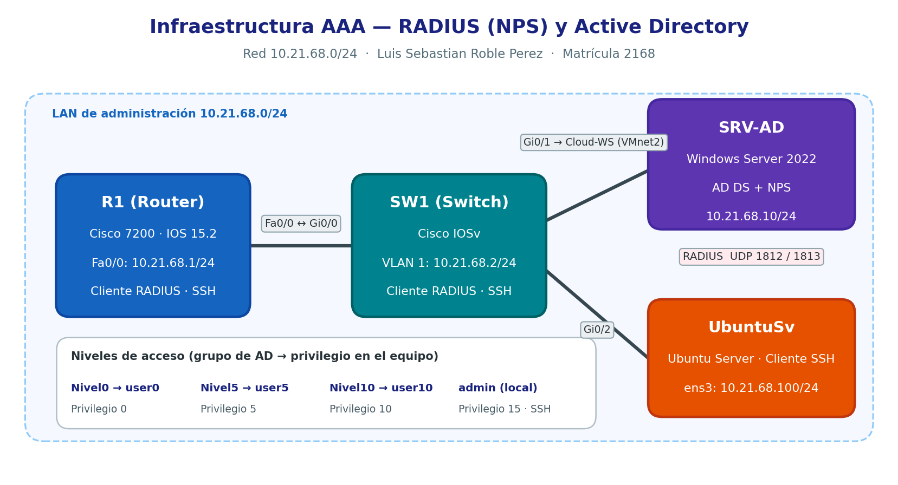

# 🔐 Laboratorio AAA, RADIUS y Windows Server NPS

  

  <strong>Implementación de autenticación, autorización y auditoría en dispositivos Cisco</strong>

  
  
  
  
  

## 📑 Índice

- [1. Introducción](#-1-introducción)
- [2. Objetivos](#-2-objetivos)
- [3. Descripción de la infraestructura](#-3-descripción-de-la-infraestructura)
- [4. Direccionamiento IP](#-4-direccionamiento-ip)
- [5. Topología de red](#-5-topología-de-red)
- [6. Configuración de los dispositivos Cisco](#-6-configuración-de-los-dispositivos-cisco)
- [7. Configuración de Windows Server NPS](#-7-configuración-de-windows-server-nps)
- [8. Usuarios y privilegios](#-8-usuarios-y-privilegios)
- [9. Pruebas de conectividad y autenticación](#-9-pruebas-de-conectividad-y-autenticación)
- [10. Registros y auditoría](#-10-registros-y-auditoría)
- [11. Archivos de configuración](#-11-archivos-de-configuración)
- [12. Video de demostración](#-12-video-de-demostración)
- [13. Conclusiones](#-13-conclusiones)

---

## 📌 1. Introducción

El presente proyecto consiste en la implementación de un laboratorio de redes y seguridad informática basado en el modelo AAA (Authentication, Authorization and Accounting).

La infraestructura integra dispositivos Cisco, un servidor Windows con Network Policy Server (NPS) y un equipo Ubuntu Server. El propósito es configurar y documentar un entorno de administración de red que permita trabajar con autenticación centralizada mediante RADIUS, controlar los permisos de acceso y revisar los registros generados durante las pruebas.

A través de esta práctica se estudia la relación entre los dispositivos de red y el servidor de autenticación, así como la importancia de establecer mecanismos que permitan verificar las credenciales de los usuarios y administrar sus privilegios.

## 🎯 2. Objetivos

### Objetivo general

Implementar y documentar un sistema AAA para la administración segura de dispositivos de red, utilizando Cisco IOS, RADIUS y Windows Server NPS.

### Objetivos específicos

- Configurar el direccionamiento IP de los dispositivos.
- Establecer conectividad entre el router, el switch y los servidores.
- Configurar los parámetros de autenticación AAA en los dispositivos Cisco.
- Registrar los dispositivos de red como clientes RADIUS.
- Configurar las políticas necesarias para procesar las solicitudes de autenticación.
- Comprobar los usuarios y sus respectivos niveles de privilegio.
- Realizar pruebas de conectividad y autenticación.
- Revisar los registros de eventos relacionados con los intentos de acceso.
- Documentar las configuraciones y evidencias obtenidas durante el laboratorio.

## 🖥️ 3. Descripción de la infraestructura

La infraestructura está compuesta por cuatro elementos principales:

| Dispositivo | Dirección IP | Función |
|---|---|---|
| Router Cisco R1 | `10.21.68.1` | Enrutamiento y administración de la red. |
| Switch Cisco SW1 | `10.21.68.2` | Conectividad y administración de la red local. |
| Windows Server | `10.21.68.10` | Servidor destinado a los servicios de autenticación NPS/RADIUS. |
| Ubuntu Server | `10.21.68.100` | Equipo Linux integrado en el laboratorio. |

El router R1 y el switch SW1 participan en las pruebas de administración y autenticación. Windows Server proporciona el servicio NPS/RADIUS cuando se encuentra configurado correctamente. Ubuntu Server forma parte del entorno de pruebas y conectividad.

La comunicación entre los dispositivos y el servidor RADIUS depende del direccionamiento, las rutas, las reglas de firewall y los parámetros de autenticación configurados.

## 🌐 4. Direccionamiento IP

El laboratorio utiliza la red privada `10.21.68.0/24`.

| Dispositivo | Dirección IP | Máscara | Puerta de enlace |
|---|---|---|---|
| Router R1 | `10.21.68.1` | `255.255.255.0` | No aplica |
| Switch SW1 | `10.21.68.2` | `255.255.255.0` | `10.21.68.1` |
| Windows Server | `10.21.68.10` | `255.255.255.0` | `10.21.68.1` |
| Ubuntu Server | `10.21.68.100` | `255.255.255.0` | `10.21.68.1` |

**Nota:** las máscaras y puertas de enlace indicadas deben coincidir con la configuración real de cada equipo.

### 4.1. Configuración IP de Windows Server

Windows Server utiliza la dirección `10.21.68.10` dentro de la infraestructura.

### 4.2. Configuración IP de Ubuntu Server

Ubuntu Server utiliza la dirección `10.21.68.100` para su integración en la red.

## 🗺️ 5. Topología de red

### 5.1. Diagrama de infraestructura

El siguiente diagrama representa los dispositivos principales y sus direcciones IP dentro del laboratorio.

El router R1 utiliza la dirección `10.21.68.1`, mientras que el switch SW1 utiliza `10.21.68.2`. Windows Server se encuentra en `10.21.68.10` y Ubuntu Server en `10.21.68.100`.

El servidor NPS debe poder recibir las solicitudes RADIUS de los dispositivos Cisco que estén registrados como clientes y configurados para utilizarlo.

### 5.2. Evidencia de la infraestructura implementada

Esta captura corresponde a la evidencia original de la infraestructura utilizada en la práctica.

El diagrama facilita la comprensión de la organización lógica de la red, mientras que la captura original sirve como evidencia del entorno implementado.

## ⚙️ 6. Configuración de los dispositivos Cisco

### 6.1. Configuración del router R1

El router R1 se configura con los parámetros de direccionamiento y administración necesarios para el laboratorio.

La configuración AAA permite definir los métodos utilizados para autenticar las conexiones administrativas. Cuando RADIUS está configurado como método de autenticación, el router puede enviar solicitudes al servidor NPS para validar las credenciales de los usuarios.

### 6.2. Configuración del switch SW1

El switch SW1 utiliza la dirección de administración `10.21.68.2`.

Su configuración contempla los parámetros de red y los mecanismos de autenticación utilizados durante las pruebas.

### 6.3. Verificación de interfaces

La verificación de las interfaces permite comprobar las direcciones IP y el estado operativo de los puertos.

El comando `show ip interface brief` presenta un resumen de las interfaces de capa 3. Para comprobar el estado de los puertos de un switch, también pueden utilizarse comandos como `show interfaces status`, dependiendo del modelo y del sistema operativo.

**Evidencia de interfaces del switch:**

**Resumen de interfaces IP:**

## 🔐 7. Configuración de Windows Server NPS

Network Policy Server (NPS) es el componente de Windows Server que permite implementar políticas de acceso a la red y procesar solicitudes de autenticación y autorización mediante RADIUS.

En este laboratorio, NPS se utiliza para centralizar la validación de los accesos de los dispositivos Cisco.

### 7.1. Clientes RADIUS

Para que NPS pueda procesar las solicitudes de autenticación, los dispositivos que actúan como clientes RADIUS deben registrarse con sus respectivas direcciones IP y secretos compartidos.

Los dispositivos del laboratorio son:

| Cliente RADIUS | Dirección IP |
|---|---|
| Router R1 | `10.21.68.1` |
| Switch SW1 | `10.21.68.2` |

El secreto compartido configurado en cada cliente RADIUS debe coincidir con el establecido en el dispositivo Cisco correspondiente.

### 7.2. Configuración de directivas de grupo

Las directivas de grupo permiten administrar determinadas configuraciones de usuarios y equipos Windows de forma centralizada, cuando el entorno está integrado en un dominio compatible.

La siguiente evidencia documenta las directivas configuradas durante la práctica.

### 7.3. Detalles de las directivas

Esta captura muestra los detalles de una de las directivas configuradas en el entorno Windows.

**Nota:** las directivas de grupo de Windows y las políticas de red de NPS son mecanismos diferentes. Las primeras administran configuraciones de usuarios y equipos Windows, mientras que las segundas determinan cómo se procesan y autorizan las solicitudes RADIUS.

### 7.4. Configuración de servidores AAA

La siguiente evidencia corresponde a la configuración relacionada con los servidores AAA del dispositivo de red.

La configuración debe verificarse junto con los parámetros de RADIUS, las políticas de autenticación y la conectividad con Windows Server.

## 👤 8. Usuarios y privilegios

En este apartado se organizan las evidencias de los usuarios por dispositivo para diferenciar las pruebas realizadas en el router R1 de las realizadas en el switch SW1.

Los niveles de privilegio observados dependen de la configuración de cada dispositivo y de las políticas de autorización aplicadas.

### 8.1. Usuarios del router R1

#### Usuario 0 en R1

Esta evidencia documenta las pruebas relacionadas con el usuario 0 en el router R1.

#### Usuario 5 y privilegios en R1

Esta captura documenta las pruebas de acceso y privilegios correspondientes al usuario 5 en R1.

#### Usuario 10 y privilegios en R1

Esta captura corresponde a las pruebas del usuario 10 y sus privilegios en el router R1.

### 8.2. Usuarios del switch SW1

#### Usuario 0 en SW1

La siguiente captura documenta la evidencia del usuario 0 en el switch.

#### Usuario 5 en SW1

Esta captura corresponde a las pruebas relacionadas con el usuario 5 en el switch SW1.

#### Usuario 10 en SW1

Esta captura documenta las pruebas relacionadas con el usuario 10 en el switch.

### 8.3. Evidencia adicional de usuarios

La siguiente captura contiene información adicional sobre los usuarios configurados en el laboratorio.

### 8.4. Privilegio administrativo nivel 15

En Cisco IOS, el nivel de privilegio 15 corresponde al nivel administrativo más alto. La configuración efectiva determina los comandos que puede ejecutar cada usuario.

Esta evidencia documenta las pruebas relacionadas con el privilegio administrativo.

La existencia de una cuenta local o de un nivel de privilegio configurado no demuestra por sí sola que la autenticación centralizada mediante RADIUS esté funcionando. Para comprobarlo, deben revisarse también las solicitudes procesadas por NPS.

## 🧪 9. Pruebas de conectividad y autenticación

Las pruebas permiten verificar la conectividad entre los dispositivos y observar el comportamiento del sistema de autenticación.

### 9.1. Pruebas de autenticación AAA

Las pruebas de autenticación permiten documentar el comportamiento del sistema ante los accesos realizados por los usuarios.

Para verificar la autenticación centralizada, es importante confirmar que las solicitudes lleguen a NPS y que el resultado corresponda con las políticas configuradas.

### 9.3. Prueba de autenticación fallida

Los intentos de autenticación fallidos permiten analizar el comportamiento del sistema cuando se introducen credenciales incorrectas o se produce un rechazo por las políticas de acceso.

El registro correspondiente en NPS permite investigar el motivo del rechazo cuando la solicitud ha sido procesada por el servidor.

## 📊 10. Registros y auditoría

Los registros de eventos permiten consultar información sobre las solicitudes procesadas y los intentos de autenticación.

La revisión de estos registros ayuda a identificar errores, diagnosticar problemas y documentar el comportamiento del sistema durante las pruebas.

### 10.1. Registros de actividad

La siguiente evidencia corresponde a los registros de actividad revisados durante el laboratorio.

### 10.2. Visor de eventos de NPS

El Visor de eventos permite consultar los eventos disponibles relacionados con los servicios de Windows y la autenticación.

Los registros deben revisarse para determinar si las solicitudes fueron aceptadas, rechazadas o afectadas por algún error de configuración.

## 📁 11. Archivos de configuración

El repositorio incluye la carpeta `show running`, donde se almacenan archivos con las configuraciones y salidas de los comandos utilizados para documentar los dispositivos.

### 11.1. Configuración del router

Archivo: [`Router.txt`](./show%20running/Router.txt)

Este archivo permite consultar la configuración documentada del router R1 y revisar los parámetros utilizados durante el laboratorio.

### 11.2. Configuración del switch

Archivo: [`SW1#show running.txt`](./show%20running/SW1%23show%20running.txt)

Este archivo contiene la configuración documentada del switch SW1 y sirve como referencia para revisar los parámetros aplicados al dispositivo.

La documentación de estas configuraciones complementa las capturas de pantalla y facilita la revisión técnica del laboratorio.

## 🎥 12. Video de demostración

El siguiente video presenta la demostración del laboratorio y permite complementar las evidencias documentadas en este repositorio.

  

  <a href="https://youtu.be/-LEGZHsq84I"><strong>▶ Ver video de demostración en YouTube</strong></a>

## ✅ 13. Conclusiones

Con este laboratorio pude trabajar con la configuración de dispositivos Cisco y la implementación de un entorno de autenticación centralizada mediante RADIUS y Windows Server NPS. También pude documentar el direccionamiento IP, organizar las pruebas de usuarios y privilegios y revisar las evidencias de conectividad y autenticación.

La práctica me permitió comprender mejor la importancia de controlar los accesos administrativos, aplicar políticas de seguridad y revisar los registros de eventos para investigar posibles errores o intentos de acceso fallidos.

Finalmente, la documentación de las configuraciones, las capturas y el video de demostración permite presentar de manera organizada el trabajo realizado y facilita su revisión.

---

  <strong>Laboratorio de redes y seguridad informática</strong> 
  AAA · RADIUS · Cisco IOS · Windows Server NPS · Ubuntu Server

